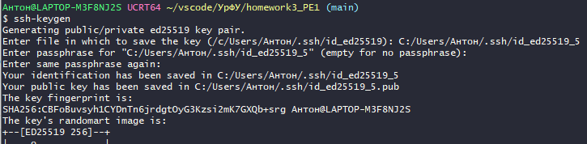
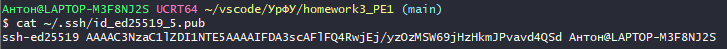
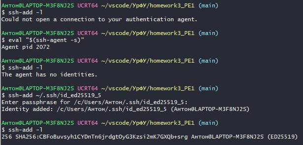
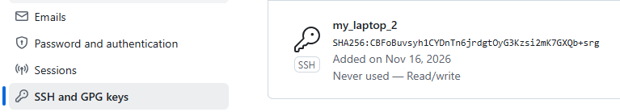
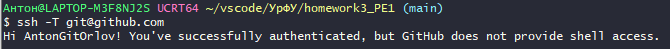
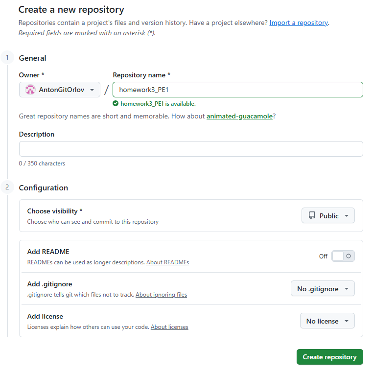
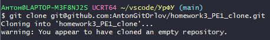
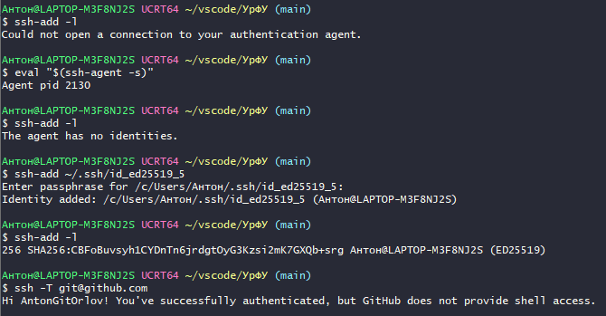

## ДЗ №3 по модулю Программная инженерия 1
### Задание

Вопросы по заданию

**Преподаватель:** Михаил Меркушов

**Выполнить следующие практические кейсы по настройке SSH-доступа к GitHub:**
1. **Установка SSH-клиента и генерация ключевой пары**  
    Проверить наличие SSH-клиента в системе, сгенерировать новую пару ключей (рекомендуется ed25519), убедиться, что приватный ключ защищён паролем (passphrase), а публичный ключ сохранён в `~/.ssh/`.

2. **Добавление публичного ключа в аккаунт GitHub**  
    Скопировать содержимое `~/.ssh/id_ed25519.pub` и добавить его в настройках GitHub (Settings - SSH and GPG keys). Приложить скриншот/подтверждение.

3. **Проверка SSH-подключения к GitHub**  
    Выполнить `ssh -T git@github.com` и убедиться, что соединение устанавливается без пароля и возвращается приветствие от GitHub.

4. **Работа с репозиторием по SSH**  
    Клонировать любой свой репозиторий по SSH-URL (`git@github.com:user/repo.git`), создать коммит и выполнить `git push` — убедиться, что операция проходит без ввода пароля (используется ключ).

Результаты должны быть загружены в git-репозиторий с описанием выполненных шагов в README.md и ссылкой на репозиторий при сдаче задания.
***
### Решение
Предварительно создаем локальный репозиторий, создаем файл README.md, добавляем его в отслеживаемые файлы и коммитим его:
```bash
git init
git add README.md
git commit -m "Inital commit"
```

Скрин:


Далее выполняем задания:
#### 1. Установка SSH-клиента и генерация ключевой пары

Генерация SSH-ключа:
```bash
ssh-keygen
```
- дополнительно прописываем путь к файлу для генерации
- создаем passphrase

Скрин:


Проверяем сохранение наличие публичного ключа:
```bash
cat ~/.ssh/id_ed25519_5.pub
```

Скрин:


Запускаю агента, добавляю ему приватный ключ:
```bash
eval "$(ssh-agent -s)"
ssh-add ~/.ssh/id_ed25519_5

ssh-add -l
```
- дополнительно проверяю, добавился ли ключ

Скрин:



#### 2. Добавление публичного ключа в аккаунт GitHub
Теперь надо связать наш компьютер с профилем на GitHub:
- идем на GitHub, в профиле находим Settings
- в левой колонке находим SSH and GPG keys
- в открывшейся странице нас интересует первый пункт SSH keys
- нажимаем кнопку New SSH key
- вводим любое название для SSH ключа в поле Title
- копируем публичный ключ из терминала (выводили в предыдущем задании)
- вставляем скопированный ключ в поле Key
- нажимаем Add SSH key

Скрин:

#### 3. Проверка SSH-подключения к GitHub
Проверяем подключение:
```bash
ssh -T git@github.com
```
- ввод пароля не потребовался

Скрин:


#### 4. Работа с репозиторием по SSH
Для целей задания решил создать репозиторий, куда в дальнейшем будет выложен данный материал.

Скрин:


Чтобы клонировать репозиторий на компьютер:
- выбираем вкладку SSH (на голубом фоне) в GitHub
- копируем ссылку на репозиторий
- открываем терминал для той папки, куда хотим клонировать репозиторий (*)
- пишем команду `git clone git@github.com:AntonGitOrlov/homework3_PE1_clone.git`
- будет создана новая папка, которая будет называться также как удаленный репозиторий
- чтобы продолжить работу с этим проектом нужно обязательно перейти в эту папку
	- можно открыть новый терминал для этой папки
	- либо через команду `cd <имя директории>`

Скрин:


- знаем, что репозиторий пустой, это нормально

***
(*) Предварительно выполнил следующие команды:
```bash
eval "$(ssh-agent -s)"
ssh-add ~/.ssh/id_ed25519_4
ssh-add -l
ssh -T git@github.com
```

Скрин:

***

Добавляем материалы в локальный репозиторий, коммитим и пушим в удаленный репозиторий:
